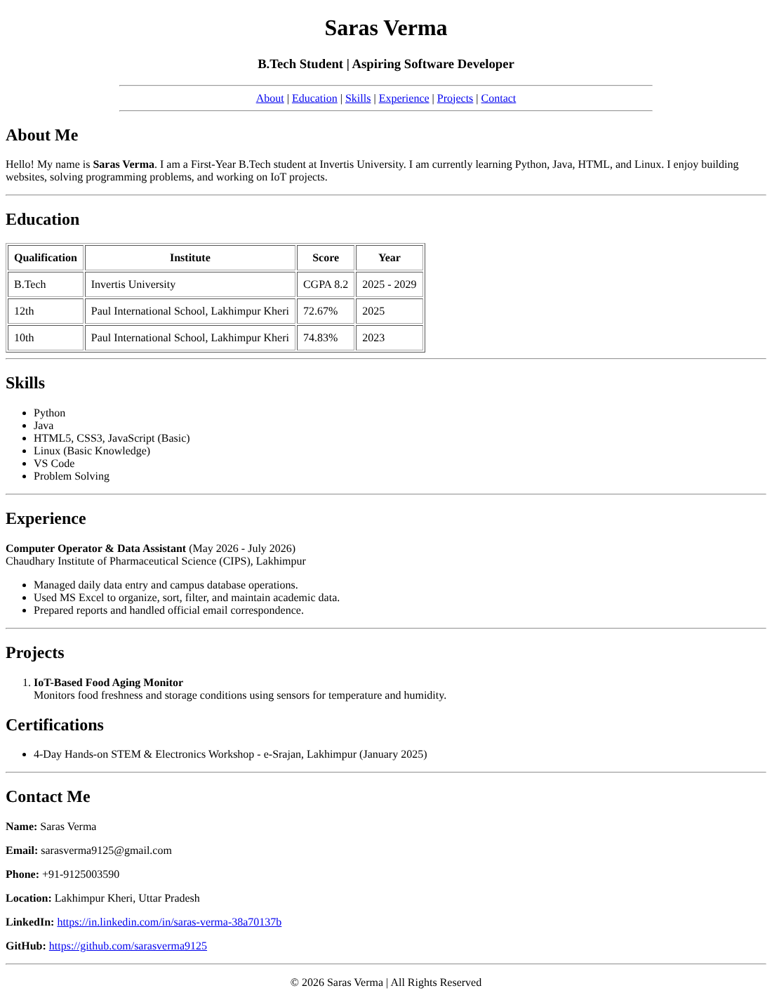

STANDARD LAB PRACTICAL EXPERIMENT FORMAT

EXPERIMENT NO. 5

1. Experiment Title: Links and Images

2. Aim:
Link two pages together and add a picture with alt text.

3. Software / Tools Required:
Visual Studio Code, Chrome Browser

4. Theory:
<a> tag creates hyperlink with href attribute.  tag displays image with src, width, height and alt attributes. alt text shows when image is missing.

5. Algorithm / Procedure:
1. Create folder Assignment 5
2. Create home.html with heading Welcome to My Site and link to portfolio.html
3. Create portfolio.html with heading and link back to home.html
4. Create portfolio-image.html with heading and img from images folder width 200 height 200 with alt text
5. Open home.html and test both links
6. Take screenshots

6. Program / Queries / Commands:
home.html:
<!-- Name: Utkarsh Yadav | Student ID: BCS2025381 | Ass: 5 -->
<!DOCTYPE html>
<html>
<head><title>Home</title></head>
<body>
<h1>Welcome to My Site</h1>

<a href="portfolio.html">portfolio</a>

</body>
</html>

portfolio.html:
<h1>My Portfolio</h1>

<a href="home.html">Back to Home</a>

portfolio-image.html:
<h1>My Photo</h1>

7. Input:
File names: home.html, portfolio.html, portfolio-image.html, Image from images folder

8. Output:
Clicking portfolio link opens portfolio page. Clicking back link returns to home. Image shows 200x200 size, if missing alt text shows. Screenshots in images folder.

9. Result:
Experiment performed successfully.
